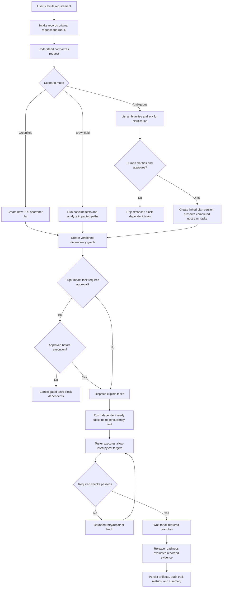

# Product Functionality Instructions

Use this instruction when changing user-visible behavior, requirement understanding, planning/scenario outcomes, or URL-shortener APIs. Preserve the existing contracts unless the requested feature explicitly changes them.

## Product purpose

The application accepts a software requirement and creates a reviewable engineering run: it analyzes the request, creates a dependency graph, executes bounded role tasks with human gates, records real validation results, and persists artifacts/audit events. The URL shortener is the demonstration product; workflow orchestration is the primary product capability.

## URL shortener contract

- `POST /api/urls`: accept a destination URL and optional expiration, validate it, create a unique code, persist it, and return metadata plus `short_link`.
- `GET /r/{code}`: resolve only the stored destination, return a temporary redirect, and attempt click analytics without allowing analytics failure to break redirection.
- `GET /api/urls/{code}`: return stored metadata; unknown codes are `404`.
- `GET /api/urls/{code}/analytics`: return a count and recent click data; unknown codes are `404`.
- `GET /health`: return service health.
- Destination URLs must be HTTP/HTTPS by default. Reject malformed URLs and unsupported schemes. Do not introduce arbitrary destination redirects or trust user-supplied redirect targets at redirect time.
- Code collisions must be handled within a bounded retry budget. Expired/inactive codes must not redirect.
- Keep analytics privacy minimal. Do not add IP collection or increase retention without an explicit requirement and documented approval.

## Requirement and scenario behavior

- Preserve the original requirement, normalized summary, acceptance criteria, assumptions, ambiguity list, risk, and scenario mode.
- The three supported scenario modes are greenfield, brownfield, and ambiguous. Brownfield plans establish a test baseline and protect existing redirect behavior. Ambiguous requests must expose unresolved decisions and pause for clarification/approval before committing to higher-impact behavior.
- A clarification that changes requirements creates a new plan version linked to its parent. Preserve completed upstream work and rerun only affected downstream work where safe.
- A task is eligible only after all dependencies succeed. Failed dependencies block downstream work unless a decision is explicit and audited. Failed required validation must never yield release readiness `GO`.
- Human approval occurs before gated work executes, not afterward. Rejection prevents the gated action and blocks dependents.

## User-visible flow



## URL creation and redirect behavior

```mermaid
sequenceDiagram
    actor Client
    participant API as FastAPI api/app.py
    participant Service as URLShortenerService
    participant Codes as codegen.py
    participant Repo as URLRepository / SQLite
    Client->>API: POST /api/urls {original_url, expires_at?}
    API->>Service: create_short_url(...)
    Service->>Service: validate_url (HTTP/HTTPS + host)
    loop bounded collision attempts
        Service->>Codes: generate_code(length)
        Codes-->>Service: candidate code
        Service->>Repo: code_exists(candidate)
        Repo-->>Service: available / collision
    end
    Service->>Repo: insert(code, destination, expiry)
    Repo-->>Service: persisted ShortURL
    Service-->>API: ShortURL
    API-->>Client: 201 metadata + short_link
    Client->>API: GET /r/{code}
    API->>Service: resolve_target(code)
    Service->>Repo: get_by_code(code)
    Repo-->>Service: stored URL record
    Service-->>API: active, unexpired record
    API->>Service: record_click(code, referrer, user_agent)
    Note over API,Service: Analytics is best-effort; its failure must not prevent redirect.
    API-->>Client: 307 Location: stored original_url
```

## Change checklist

- Keep route behavior, service rules, and persistence behavior aligned; put domain rules in `url_shortener/service.py`, not duplicated in route handlers.
- Add/update deterministic tests for happy path, invalid input, unknown code, collision/expiry, and analytics failure as relevant.
- For workflow behavior, cover legal transitions, dependency blocking, approvals, retries, safe-stop/replanning, and readiness evidence in scenario tests.
- Update the API/architecture/scenario docs when contracts or scenario behavior change. Never describe proposed work as applied or model claims as executed validation.
