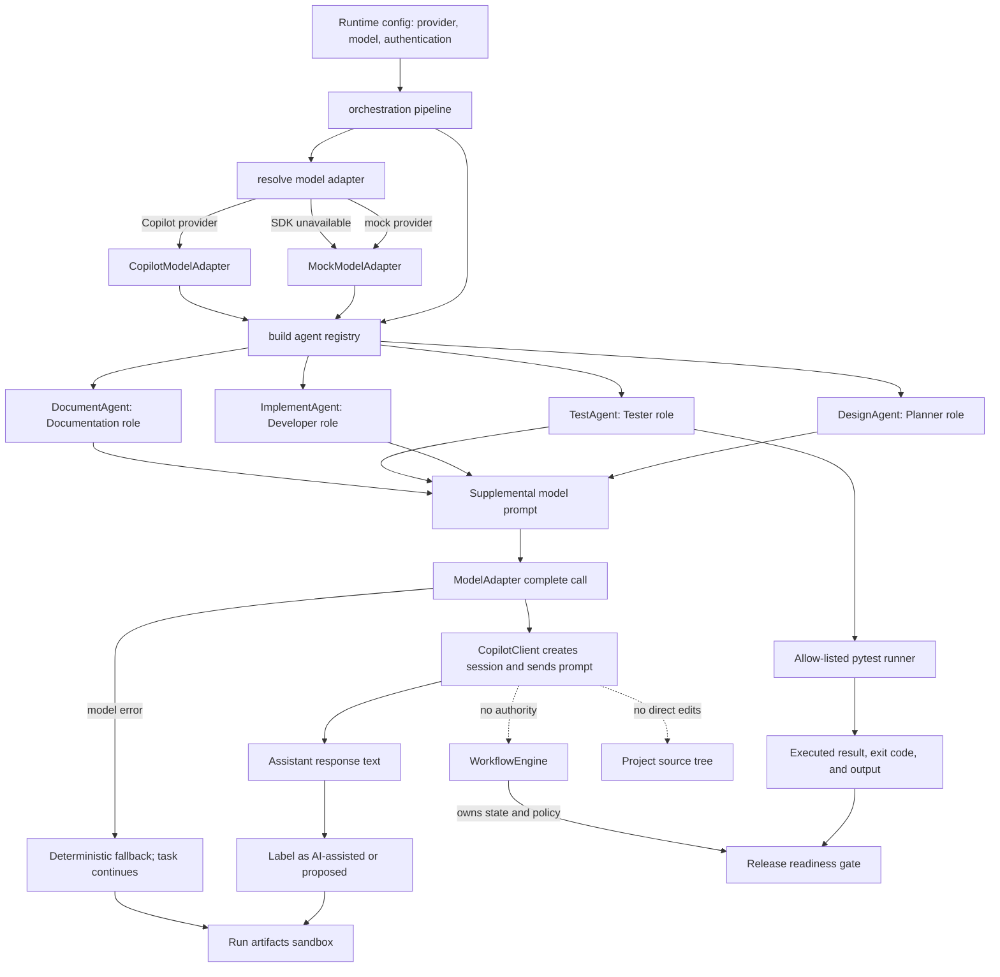
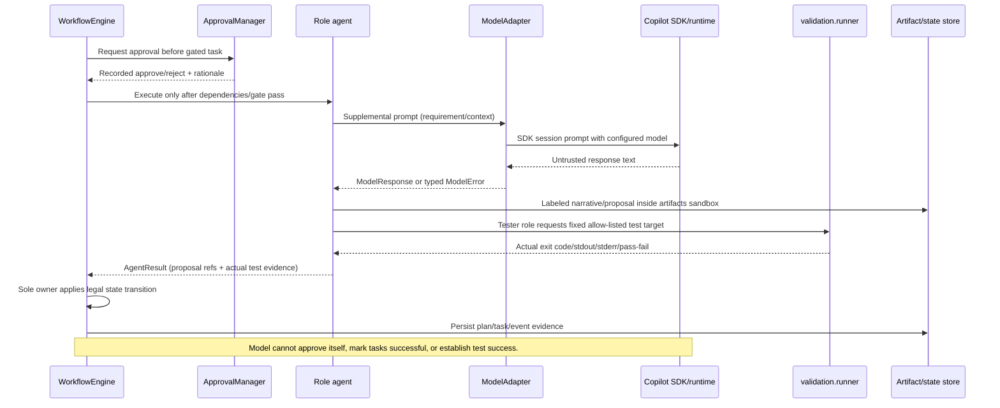

# Technical Architecture and AI Boundaries

Use this instruction for implementation changes. Keep SDK-specific details in `model/`, workflow state ownership in `orchestration/`, and domain behavior in `url_shortener/`. Verify SDK APIs against the installed package/official docs; never invent methods.

## Source map

| Concern                         | Owning code                                                                                                         | Responsibility                                                                                                                                           |
| ------------------------------- | ------------------------------------------------------------------------------------------------------------------- | -------------------------------------------------------------------------------------------------------------------------------------------------------- |
| Runtime configuration           | `src/agentic_engineer/config.py`, `.env.example`                                                                | Environment settings including`AI_PROVIDER` (Copilot default), `COPILOT_MODEL`, timeouts, storage, concurrency, retries.                             |
| Requirement analysis            | `src/agentic_engineer/requirements/analyzer.py`                                                                   | Deterministic normalization, assumptions, ambiguities, acceptance criteria, risk, and mode.                                                              |
| Task schemas/transition rules   | `src/agentic_engineer/planning/models.py`                                                                         | Typed`Task`, `PlanVersion`, `TaskState`, graph readiness and legal transitions.                                                                    |
| Scenario task graphs/replanning | `src/agentic_engineer/planning/planner.py`                                                                        | Greenfield, brownfield, ambiguous DAGs, clarification replanning, bounded repair task construction.                                                      |
| State owner/scheduler           | `src/agentic_engineer/orchestration/engine.py`                                                                    | Sole owner of task transitions, dependency scheduling, concurrency barriers, retries, approval, safe-stop, blocking, and replan dispatch.                |
| Application wiring              | `src/agentic_engineer/orchestration/pipeline.py`                                                                  | Resolves adapter, builds registry and services, starts a workflow run.                                                                                   |
| Agent roles                     | `src/agentic_engineer/agents/base.py`, `mock_agents.py`                                                         | Agent protocol/registry and role implementations. All model calls pass via`ModelAdapter`.                                                              |
| Model abstraction               | `src/agentic_engineer/model/adapter.py`, `__init__.py`, `mock_adapter.py`                                     | Shared protocol/errors, provider selection, deterministic fake.                                                                                          |
| Copilot SDK boundary            | `src/agentic_engineer/model/copilot_adapter.py`                                                                   | SDK import, client/session lifecycle, authentication handoff, model selection, send/wait, error normalization. No other module should import`copilot`. |
| URL API/domain                  | `src/agentic_engineer/api/app.py`, `url_shortener/service.py`, `repository.py`, `codegen.py`, `models.py` | HTTP mapping, URL validation, code creation, redirect/analytics rules, SQLite persistence, typed domain models.                                          |
| Permission/policy               | `src/agentic_engineer/approvals/`, `policies/guardrails.py`                                                     | Human decisions, path sandbox, test allow-list, redaction, safety rules.                                                                                 |
| Test execution                  | `src/agentic_engineer/validation/runner.py`                                                                       | Real pytest subprocess with allow-listed targets and bounded timeout.                                                                                    |
| State/evidence                  | `src/agentic_engineer/persistence/`, `observability/`, `reporting/`                                           | Persistent runs/plans, append-only audit events, computed metrics, inspectable reports.                                                                  |

## Where AI intervenes today

- Provider resolution happens in `model.resolve_adapter()` called by `orchestration.pipeline.run_requirement()`.
- The default is `CopilotModelAdapter` when `AI_PROVIDER` is unset or `copilot`; `AI_PROVIDER=mock` selects the deterministic adapter. Copilot requires SDK installation and working authentication. The role helpers catch `ModelError` and retain deterministic output on failure.
- Model calls are currently made only in `DesignAgent`, `ImplementAgent`, `TestAgent`, and `DocumentAgent` in `agents/mock_agents.py`.
- The requirement analyzer, task graph planner, scheduler, approval decisions, state transitions, and readiness gates do **not** ask the model to decide their behavior.
- Developer output is a proposal only; it does not edit project source. The Tester may request proposed test ideas, but only `validation.runner.run_tests()` supplies executed test evidence. Test pass/fail—not model claims—controls downstream readiness.
- Model output is currently supplemental narrative. Treat it as untrusted text: do not parse it into executable commands, task state, file paths, acceptance success, or permissions without explicit schema validation and policy checks.

## AI/runtime control-flow diagram

## Trust and permission boundaries

## Safety requirements for future AI/tool work

- Keep SDK lifecycle, auth, model selection, timeout, and SDK exception handling inside `model/`. Do not import SDK types into domain or scheduler modules.
- Every role has distinct responsibilities; add per-role instructions/system context rather than relying on an unused role label. Validate any structured output before use.
- Do not grant model tool execution by default. If tools are introduced, explicitly allow-list tools, deny shell/filesystem/network/deployment by default, and require narrow handlers, timeouts, approval as appropriate, and audit records. SDK permission approval must not be confused with the application's human approval gate.
- Do not send secrets in prompts, artifacts, or logs. Keep credentials in environment/SDK authentication and redact recorded details.
- Developer agents may propose patches, but must not apply them unless a separate, explicit patch-validation/application workflow is added. That workflow must constrain paths to the workspace, validate the patch, gate high-impact edits, apply with controlled code, and run actual tests afterward.
- Only `WorkflowEngine` mutates task state. Agents return outcomes; they never transition tasks or decide retries/readiness.
- Use deterministic mock responses in normal tests. Live SDK tests must be opt-in and must never make the suite depend on a Copilot subscription/network.
- When changing a behavior, add tests at the narrowest owning layer and update the matching API/architecture/testing documentation.
