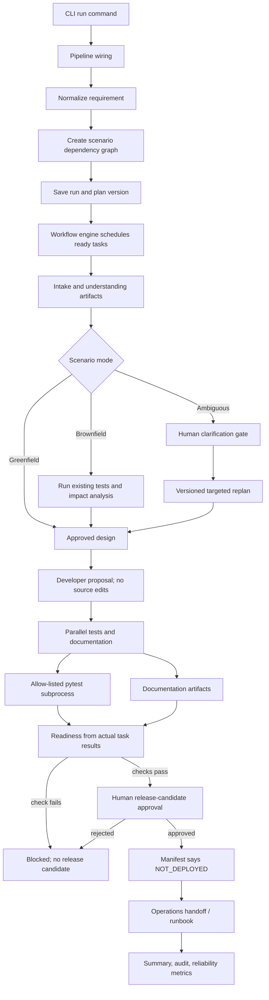

# Application Guide

This document explains the application end to end: the URL-shortener service, the agentic SDLC workflow, where Copilot participates, what can and cannot be said about AI credits, and what each repository file is for.

## What the application is

The repository contains two related applications:

1. A runnable FastAPI + SQLite URL shortener (`serve` command).
2. An agentic engineering workflow (`run` command) that accepts requirements, plans a task graph, calls role agents, validates with pytest, and records release-candidate evidence.

The workflow is the main demonstration. It is a governed SDLC **prototype**, not a production deployment platform. The Developer agent proposes source changes as artifacts; it does not patch the source tree. Release approval records a candidate, while deployment remains explicitly `NOT_DEPLOYED`.

## Set up and run it

Run commands from the repository root. Python 3.11 or newer is required; the
project was tested locally with Python 3.12. On Windows, create a virtual
environment and install the application plus development tools:

```powershell
py -m venv .venv
.\.venv\Scripts\python.exe -m pip install -e ".[dev]"
```

The Copilot SDK is installed by the normal project dependencies. Before a live
Copilot run, authenticate using the Copilot CLI or provide one of the supported
GitHub token environment variables. The application reads settings from the
process environment; `.env.example` is a reference and is not automatically
loaded as a dotenv file.

```powershell
# Run a scenario with the configured provider (Copilot by default)
.\.venv\Scripts\python.exe -m agentic_engineer.cli run --example examples/greenfield.json

# Brownfield and clarification-gated scenarios
.\.venv\Scripts\python.exe -m agentic_engineer.cli run --example examples/brownfield.json
.\.venv\Scripts\python.exe -m agentic_engineer.cli run --example examples/ambiguous.json

# Supply a custom requirement; --auto-approve is demo convenience only
.\.venv\Scripts\python.exe -m agentic_engineer.cli run --requirement "Create a URL shortener with click analytics." --auto-approve

# Start the URL shortener API
.\.venv\Scripts\python.exe -m agentic_engineer.cli serve

# Inspect a run and its reliability metrics
.\.venv\Scripts\python.exe -m agentic_engineer.cli inspect <run_id>
.\.venv\Scripts\python.exe -m agentic_engineer.cli metrics --run-id <run_id>
```

To run deterministically without Copilot authentication, set the provider to
`mock` in the current shell and pass `--auto-approve` if the scenario should
not pause at approval gates:

```powershell
$env:AI_PROVIDER = "mock"
.\.venv\Scripts\python.exe -m agentic_engineer.cli run --example examples/greenfield.json --auto-approve
```

`run` prints a `run_id` and completion status. A normal run retains human
approval gates; `--auto-approve` approves every gate and is not a production
approval policy. See [scenarios.md](scenarios.md) for the expected results and
clarification flow. Use [api.md](api.md) for HTTP routes and request examples.

## End-to-end workflow



### Workflow sequence

1. `cli.py` reads `--requirement` or an example JSON file, applies CLI overrides, then calls `orchestration.pipeline.run_requirement()`.
2. The pipeline constructs the state store and audit log, resolves a model adapter, builds the agent registry and approval manager, runs the deterministic requirement analyzer, and asks the planner for a scenario DAG.
3. The workflow engine persists the run/plan, owns every task-state transition, and dispatches dependency-ready tasks in bounded parallel batches. Waiting for the batch provides synchronization barriers.
4. Approval-required tasks pause before execution. Rejection cancels that task and blocks its descendants. Ambiguous requirements request human clarification; clarification creates a linked plan version and preserves completed upstream tasks.
5. The Developer task writes a **proposed** change note/diff into the run artifact sandbox. It does not change application source.
6. Tester tasks may ask Copilot for proposed edge cases, then actually invoke pytest through `validation.runner` using an allow-listed target and timeout. The subprocess exit code and captured output are the validation evidence.
7. Readiness evaluates dependency results. A passing report is only a release candidate; the separate release-approval task is human gated. Approval writes `release_manifest.json` with `deployment_state: NOT_DEPLOYED`.
8. The operations-handoff task writes a checklist/runbook. It does not configure a cloud environment or deploy anything. The summary and all run evidence remain under `.runs/<run_id>/`.

The URL-shortener HTTP app is separate: `cli serve` starts FastAPI; the API calls the service layer; the service validates destinations and uses the SQLite repository. Redirect analytics are best-effort so analytics failure cannot prevent redirection. See [API reference](api.md).

## AI and Copilot use

### When Copilot is selected

`config.py` defaults `AI_PROVIDER` to `copilot` and `COPILOT_MODEL` to `gpt-5`. `orchestration/pipeline.py` calls `model.resolve_adapter()`, which wires a `CopilotModelAdapter` into the four model-assisted role agents. Set `AI_PROVIDER=mock` for offline deterministic behavior. If the SDK cannot be imported, adapter resolution falls back to mock; authentication/timeout/unavailable/empty-response failures at a role call are caught and the agent continues with deterministic output.

The runtime adapter creates a short-lived SDK client and session per model call, sends one prompt using `send_and_wait()`, reads the assistant text, then closes the session/client. It passes `available_tools=[]`: Copilot receives no built-in SDK tools through this integration. Model output is untrusted text and is only added to labeled artifacts; it cannot transition tasks, approve a release, execute shell commands, or count as test evidence.

### Which roles call the model

| Role/task | Model prompt purpose | Actual authority |
|---|---|---|
| Planner / `design` | Review the deterministic design for remaining ambiguity/risk. | Adds labeled review text; human approval and planner own decisions. |
| Developer / `implement` | Propose source changes for the requirement. | Writes proposed notes/diff only; applies no code. |
| Tester / `test` | Suggest test edge cases. | Suggestions are marked proposed. Only allow-listed pytest execution supplies pass/fail evidence. |
| Documentation / `document` | Draft short risk/trade-off notes. | Adds optional notes to a run artifact. |
| Intake, Understand, impact analysis, clarification, readiness, release approval, operations handoff, summary | No Copilot request in the current implementation. | Deterministic application logic and/or human decision. |

The role argument is passed to the model adapter interface but is not currently sent as a distinct SDK agent/system role. The prompts themselves distinguish the tasks.

### Typical Copilot calls per successful scenario

Counts below are for the current task graphs with `AI_PROVIDER=copilot`, no retries, and every role task running. They count **model requests**, not credits:

| Scenario | Calls by role | Approximate calls |
|---|---|---:|
| Greenfield | design (1), implement (1), unit test (1), integration test (1), document (1) | 5 |
| Brownfield | baseline test (1), design (1), implement (1), regression test (1), analytics test (1), document (1) | 6 |
| Ambiguous | post-clarification design (1), implement (1), unit test (1), document (1) | 4 |

A retry/re-execution can add calls. If `AI_PROVIDER=mock`, these calls are skipped. The full automated test suite normally uses mock adapters and its live smoke test runs only when `COPILOT_SDK_LIVE_TEST=1`.

## AI credits and usage accounting

**This application does not currently calculate or persist Copilot token usage or AI credits.** Its `observability/metrics.py` reports workflow reliability (run success, retry/rollback frequency, latency, MTTR), not model spend. `CopilotModelAdapter` also does not currently read SDK usage metrics or write token counts into audit events. Therefore this repository cannot provide an exact per-run credit total; role-call counts above are only a rough request count.

As of June 1, 2026, GitHub's current Copilot billing model is usage-based: cost
depends on the selected model and the input, output, and cached tokens consumed.
GitHub's pricing documentation defines one AI Credit as $0.01 USD and describes
plan allowances and additional-usage billing. Legacy annual plans may retain
request-based billing rules, so the account's plan and GitHub's current billing
page remain authoritative. Prompt and response sizes vary; never equate one
application model call with a fixed credit cost or rely on a copied model-price
table.

The Copilot SDK exposes per-session usage through
`session.rpc.usage.get_metrics()` and model pricing through
`client.rpc.models.list()`. In this application, each completion creates a
short-lived client and session; the session is disconnected immediately after
the response, and the adapter does not read or persist usage metrics. A future
meter would need to capture metrics before disconnecting, associate them with
the run/task/model, and clearly distinguish raw SDK measurements from billed
account totals. The SDK documentation shows a nano-AIU conversion example, but
the application should verify that conversion against the current GitHub billing
definitions before presenting a per-run AI Credit total.

References:
- [Copilot SDK usage and billing](https://docs.github.com/en/copilot/how-tos/copilot-sdk/features/usage-and-billing)
- [GitHub Copilot billing and usage](https://docs.github.com/en/copilot/concepts/billing-and-usage)
- [GitHub Copilot model pricing](https://docs.github.com/en/copilot/reference/copilot-billing/models-and-pricing)

## Persisted run evidence and metrics

Each `.runs/<run_id>/` directory contains:

- `run.json`: run ID, original requirement, scenario mode, status, timestamps, and current plan pointer.
- `plans/plan-v<N>.json`: tasks, dependency edges, state, attempts, approval decisions, outputs, and plan lineage.
- `current_plan.json`: current plan ID/version.
- `events.jsonl`: append-only audit events such as task attempts, outcomes, retries, approvals, blocks, replan, and run completion.
- `artifacts/`: requirement and normalized requirement, design/proposal docs, proposed-test notes, executed pytest reports, readiness report, release manifest, operations runbook, and final summary.

Reliability metrics are computed from `events.jsonl`; no model token/credit totals are currently in those metrics. Use `cli inspect <run_id>` for the graph/audit trail and `cli metrics` for aggregate reliability measures.

These generated run files are local evidence, not tracked source files. Other
ignored local directories may include `.data/` (SQLite database), `.venv/`
(Python environment), `build/` and `dist/` (package outputs), and test caches.

## File-by-file map

### Root and repository configuration

| File | Purpose |
|---|---|
| `README.md` | Quick start, commands, CI behavior, limitations. |
| `AGENTS.md` | Instructions for coding agents working on this repository. |
| `SKILLS.md` | Runtime agent roles and permissions. |
| `DOCUMENTATION.md` | Documentation index. |
| `pyproject.toml` | Package metadata, runtime/dev/build dependencies, Python floor, pytest configuration. |
| `.env.example` | Example runtime settings; contains no actual credentials. |
| `.gitignore` | Excludes secrets, virtualenvs, local state, caches, and build artifacts. |
| `.github/workflows/ci.yml` | Test, dependency audit, and wheel-build CI matrix. |
| `.github/instructions/functionality.instructions.md` | Product behavior, API contracts, and scenario behavior instructions. |
| `.github/instructions/technicality.instructions.md` | Technical file ownership, Copilot boundary, and safety instructions. |

### Application source (`src/agentic_engineer/`)

| File | Purpose |
|---|---|
| `__init__.py` | Package marker. |
| `config.py` | Environment-based settings and defaults. |
| `cli.py` | `run`, `inspect`, `metrics`, and `serve` commands. |
| `agents/__init__.py` | Agent package marker. |
| `agents/base.py` | Agent protocol, result model, and task-type registry. |
| `agents/mock_agents.py` | Planner/Developer/Tester/Documentation roles plus deterministic bookkeeping, release, and operations agents. |
| `api/__init__.py` | API package marker. |
| `api/app.py` | FastAPI construction, request/response models, and URL-shortener routes. |
| `approvals/__init__.py` | Approval package marker. |
| `approvals/manager.py` | Approval record, interactive/scripted/auto approval strategies. |
| `model/__init__.py` | Adapter exports and provider resolution. |
| `model/adapter.py` | Model protocol, response structure, and normalized model errors. |
| `model/copilot_adapter.py` | Copilot SDK authentication handoff, client/session lifecycle, tool-disabled session, response extraction. |
| `model/mock_adapter.py` | Deterministic offline/test adapter. |
| `observability/__init__.py` | Observability package marker. |
| `observability/audit.py` | Append-only per-run JSONL event log and redaction. |
| `observability/metrics.py` | Reliability metrics derived from recorded events; not AI credit accounting. |
| `orchestration/__init__.py` | Orchestration package marker. |
| `orchestration/engine.py` | Central scheduler, state transitions, retries/repair, approvals, safe stop, rollback, replan. |
| `orchestration/pipeline.py` | Dependency wiring and requirement-to-run entry point. |
| `persistence/__init__.py` | Persistence package marker. |
| `persistence/state_store.py` | JSON run/plan persistence and artifact directories. |
| `planning/__init__.py` | Planning package marker. |
| `planning/models.py` | Task/plan models, task states, transition constraints, dependency graph. |
| `planning/planner.py` | Greenfield/brownfield/ambiguous task graphs, repair creation, clarification replanning. |
| `policies/__init__.py` | Policy package marker. |
| `policies/guardrails.py` | Artifact path sandbox, pytest target allowlist, URL/sensitive-string policies. |
| `reporting/__init__.py` | Reporting package marker. |
| `reporting/summary.py` | Human-readable run inspection report. |
| `requirements/__init__.py` | Requirement package marker. |
| `requirements/analyzer.py` | Deterministic summary, criteria, ambiguity, assumption, risk, and mode detection. |
| `url_shortener/__init__.py` | URL-shortener package marker. |
| `url_shortener/codegen.py` | Random short-code generation. |
| `url_shortener/models.py` | URL/click domain records and domain exceptions. |
| `url_shortener/repository.py` | Parameterized SQLite schema and data access. |
| `url_shortener/service.py` | URL validation, code creation, redirect resolution, analytics behavior. |
| `validation/__init__.py` | Validation package marker. |
| `validation/runner.py` | Bounded pytest subprocess runner restricted to approved test targets. |

### Tests

| File | Purpose |
|---|---|
| `tests/conftest.py` | Adds the source tree to the test import path. |
| `tests/unit/test_codegen.py` | Short-code length/alphabet/generation checks. |
| `tests/unit/test_repository.py` | SQLite persistence, uniqueness, and click-event tests. |
| `tests/unit/test_url_service.py` | URL validation, expiry, collisions, redirect resolution, analytics tests. |
| `tests/integration/test_api.py` | FastAPI endpoint behavior tests. |
| `tests/integration/test_model_adapter.py` | Mock/provider selection, SDK tool-disable behavior, and opt-in live Copilot smoke test. |
| `tests/scenarios/test_orchestrator.py` | Scheduling, dependencies, parallelism, approvals, retries, safe-stop, replan, release gate, and handoff tests. |
| `tests/scenarios/test_scenarios.py` | Greenfield, brownfield, and ambiguous end-to-end scenarios with actual pytest execution. |
| `tests/**/__init__.py` | Test package markers. |

### Documentation and example requirements

| Path | Purpose |
|---|---|
| `docs/api.md` | URL-shortener API contract and errors. |
| `docs/architecture.md` | Component ownership, workflow semantics, persistence, and boundaries. |
| `docs/scenarios.md` | How to run and inspect the required scenarios. |
| `docs/security-and-guardrails.md` | Approval, policy, privacy, and security controls. |
| `docs/testing.md` | Test layers and CI verification approach. |
| `docs/tradeoffs-and-limitations.md` | Deliberate simplifications and production gaps. |
| `docs/application-guide.md` | This end-to-end workflow, AI usage, billing caveats, run evidence, and file inventory. |
| `examples/greenfield.json` | New URL-shortener requirement. |
| `examples/brownfield.json` | Backward-compatible analytics requirement. |
| `examples/ambiguous.json` | Requirement requiring clarification. |
