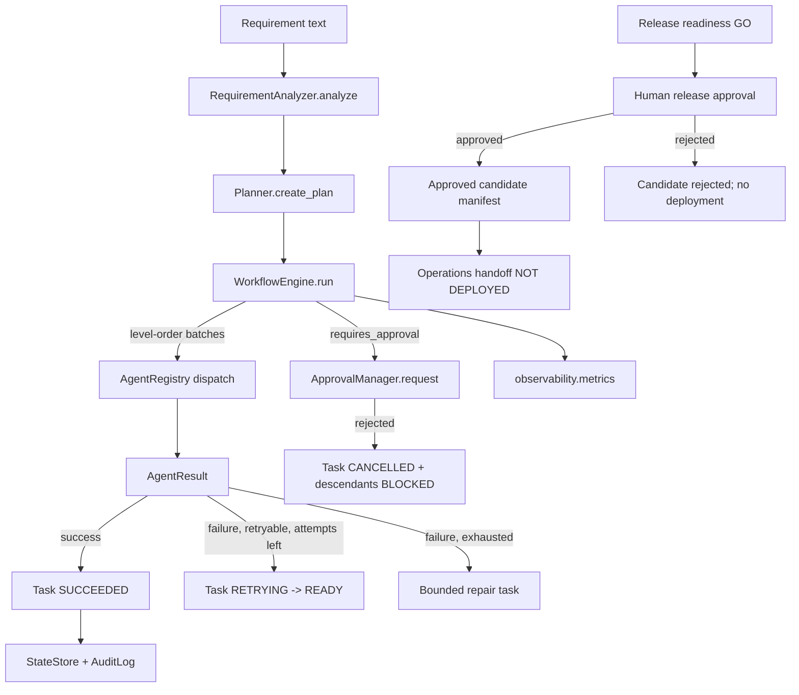

# Architecture

## Components

| Component | Module | Responsibility |
|---|---|---|
| Requirement analyzer | `requirements/analyzer.py` | Rule-based normalization: acceptance criteria, assumptions, ambiguities, risk, mode (greenfield/brownfield/ambiguous). |
| Planner | `planning/planner.py` | Builds a dependency-ordered `Task` graph per scenario mode; supports replanning after clarification and bounded repair-task creation. |
| Task graph model | `planning/models.py` | `Task`, `TaskState` (11 states), legal state-transition table, `TaskGraph` (readiness, descendants, blocking). |
| Workflow engine | `orchestration/engine.py` | Owns all state transitions. Schedules ready tasks in batches (level-order BFS over the DAG) via a bounded thread pool, which gives natural parallelism within a level and a synchronization barrier between levels. Handles approval pauses, bounded retries, bounded repair, blocking cascades, replanning, safe-stop, rollback. |
| Agent registry & agents | `agents/` | `Agent` protocol + `AgentRegistry` (task_type → agent). Roles: Planner (`design`), Developer (`implement`, proposes only), Tester (`test`, real allow-listed pytest), Documentation (`document`), Release approval (`release_approval`, approval record and candidate manifest only), Operations handoff (`operations_handoff`, runbook with deployment still pending). Plus intake/understand/impact_analysis/clarification/release_readiness/summarize. |
| Model adapter | `model/` | `ModelAdapter` protocol hides all GitHub Copilot SDK/auth/transport details from the rest of the system. `CopilotModelAdapter` (real `github-copilot-sdk`, default) and `MockModelAdapter` (explicit offline/testing mode) share one `complete(prompt, role, timeout_seconds) -> ModelResponse` method. `resolve_adapter(settings)` selects Copilot by default; set `AI_PROVIDER=mock` for deterministic offline use. Role agents call this on top of their deterministic output — a model failure (auth/timeout/unavailable/empty-response) is caught and never fails the task. |
| Approval manager | `approvals/manager.py` | Pause/resume gate. Auto-approve (demo), scripted `decision_fn` (tests), or interactive CLI prompt. Every decision is recorded with approver, rationale, timestamp, and (for clarification) resolution notes. |
| Policy guardrails | `policies/guardrails.py` | URL scheme allow-list, output-path sandboxing (no path traversal out of a run's artifact directory), test-target allow-list (no arbitrary shell commands), secret redaction for audit logs. |
| Validation subsystem | `validation/runner.py` | Executes `python -m pytest <allowlisted dirs>` as a subprocess with a timeout; never accepts an agent-supplied command string. |
| CI quality gates | `.github/workflows/ci.yml` | On pull requests and pushes to `main`/`master`, runs pytest on Python 3.11/3.12, `pip-audit --skip-editable` for third-party dependencies, and wheel build; uploads test/package evidence. Uses mock AI so CI does not require credentials. |
| State store | `persistence/state_store.py` | JSON files per run: `run.json`, `plans/plan-v{N}.json`, `current_plan.json`. Human-inspectable, survives process restarts. |
| Audit/event log | `observability/audit.py` | Append-only JSON Lines (`events.jsonl`) per run. One line per recorded action (attempt, success, failure, retry, approval, block, repair, replan, rollback, run lifecycle). |
| Metrics | `observability/metrics.py` | Computes success rate, retry frequency, rollback frequency, latency, MTTR strictly from `events.jsonl` — never fabricated. |
| URL shortener | `url_shortener/`, `api/` | The actual demo application: FastAPI + SQLite, independent of the orchestrator and fully runnable on its own. |

## Control flow

## Task graph semantics

- A task becomes eligible to run only when every task in `depends_on` is `SUCCEEDED`.
- The engine evaluates readiness in **levels**: all currently-eligible tasks are submitted to a bounded `ThreadPoolExecutor` and the engine waits for the whole batch before re-evaluating readiness. This gives genuine parallel execution of independent tasks *and* a synchronization barrier for free — no extra condition-variable bookkeeping is needed.
- `requires_approval=True` tasks pause in `WAITING_FOR_APPROVAL` **before** the agent executes, not after.
- A task that exhausts its retry budget is marked `BLOCKED` and, once per task, the engine creates a single bounded repair task (`<id>-repair-1`) that takes over the role of the failed task for any dependents. If the repair task also fails, the failure propagates as `BLOCKED` through the normal dependency-blocking mechanism — no unbounded repair loops.
- A successful readiness report is scoped to a release candidate only. It is followed by a separate human approval task; rejection blocks the operations handoff and summary. Approval writes `release_manifest.json` with `deployment_state: NOT_DEPLOYED`.
- `operations_handoff` writes `operations_runbook.md` listing required production controls and known gaps. It is a planning/evidence artifact; it does not configure monitoring or deploy services.
- Replanning (used by the ambiguous scenario after a clarification answer) creates a new `PlanVersion` with `parent_plan_id` pointing at the prior plan. Already-`SUCCEEDED` tasks are carried over unchanged (not re-run); only downstream tasks are regenerated, carrying the clarification's resolution notes into their acceptance criteria.
- Safe-stop (`engine.request_safe_stop()`) prevents any *new* task batch from being scheduled. Tasks already dispatched in the current batch are allowed to finish — the engine cannot safely force-kill a running thread/subprocess (documented limitation).
- Rollback (`engine.rollback_task(task_id)`) only applies to a task in the `FAILED` state and only reverses that task's own recorded artifact writes (`output_refs`). Anything the system cannot reliably reverse is left for a human to handle.

## State persistence & decision lineage

Every run gets `.runs/<run_id>/` containing `run.json`, `plans/plan-v*.json`, `current_plan.json`, `events.jsonl`, and `artifacts/*`, including readiness, approval manifest, operations handoff, and validation reports. This is enough for a reviewer to reconstruct what was decided, by whom, and why, without re-running anything.

## Agent boundaries

Agents only *propose* an `AgentResult` (success/failure, output refs, retryable flag). They never mutate task state directly, never choose to retry themselves, and never bypass the approval gate — the engine owns all of that. Agents also cannot write outside their run's sandboxed `artifacts/` directory (`policies.guardrails.validate_output_path`) and the Tester role can only execute pytest against an explicit directory allow-list, never an arbitrary command.

### Distinct roles and permissions

| Role | Task type | May call the model? | May execute a subprocess? | Can claim "applied"? |
|---|---|---|---|---|
| Planner | `design` | yes (optional) | no | no |
| Developer | `implement` | yes (optional) | no | **never** — only ever proposes; `implementation_notes.md`/`diff.md` are explicitly labeled PROPOSED/not applied |
| Tester | `test` | yes, for a separate *proposed* test note only | **yes** — the only role that imports `validation/runner.py` | no — executed results are clearly labeled EXECUTED, separate from any PROPOSED note |
| Documentation | `document` | yes (optional) | no | no |

The model adapter is never assumed to be live: every role falls back to deterministic, tested output when the model is unconfigured, unauthenticated, times out, or returns nothing. The SDK session is created with `available_tools=[]`; the adapter does not grant Copilot shell/filesystem tools or auto-approve tool calls.
